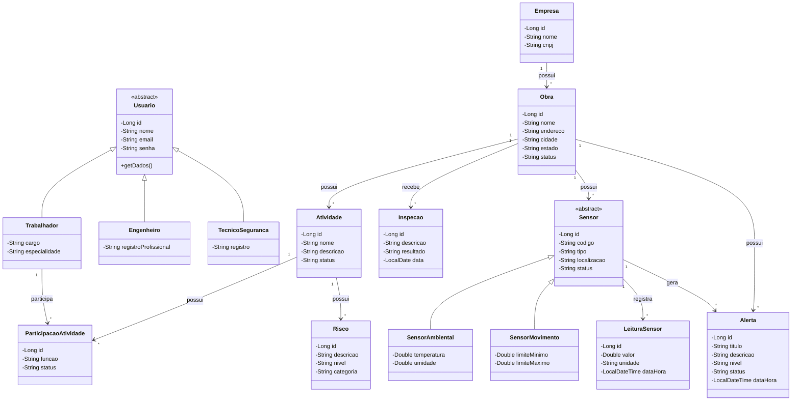

# UML — Diagrama de Classes do ObraSegura

## 1. Visão Geral

O diagrama de classes do ObraSegura representa a estrutura orientada a objetos do sistema, demonstrando as principais entidades, suas responsabilidades, atributos e relacionamentos.

O projeto utiliza conceitos de Programação Orientada a Objetos (POO), como:

- Encapsulamento
- Herança
- Abstração
- Polimorfismo

## 2. Diagrama de Classes

## 3. Relacionamentos

### Usuários

A classe `Usuario` é abstrata e serve como base para diferentes perfis do sistema:

- `Trabalhador`
- `Engenheiro`
- `TecnicoSeguranca`

Essa estrutura permite compartilhar características comuns e especializar os usuários conforme suas responsabilidades.

### Empresas e Obras

Uma empresa pode possuir várias obras, enquanto cada obra está vinculada a uma empresa.

### Obras e Atividades

Uma obra pode possuir diversas atividades, permitindo organizar e monitorar as tarefas executadas no canteiro.

### Atividades, Trabalhadores e Participações

A classe `ParticipacaoAtividade` representa a relação entre trabalhadores e atividades, permitindo registrar a participação e função desempenhada.

### Atividades e Riscos

Cada atividade pode apresentar diferentes riscos ocupacionais, que podem ser identificados e classificados.

### Obras e Inspeções

As inspeções são associadas às obras, permitindo registrar verificações de segurança e seus resultados.

### Sensores

A classe `Sensor` é abstrata e possui especializações:

- `SensorAmbiental`
- `SensorMovimento`

Os sensores estão vinculados às obras e podem registrar leituras.

### Leituras e Alertas

Os sensores registram leituras por meio da classe `LeituraSensor`.

Quando uma situação potencialmente anormal é identificada, o sistema pode gerar um `Alerta`, associado ao sensor e à obra.

## 4. Aplicação dos Conceitos de POO

| Conceito | Aplicação no ObraSegura |
|---|---|
| Abstração | Classes `Usuario` e `Sensor` |
| Herança | Especializações de `Usuario` e `Sensor` |
| Encapsulamento | A